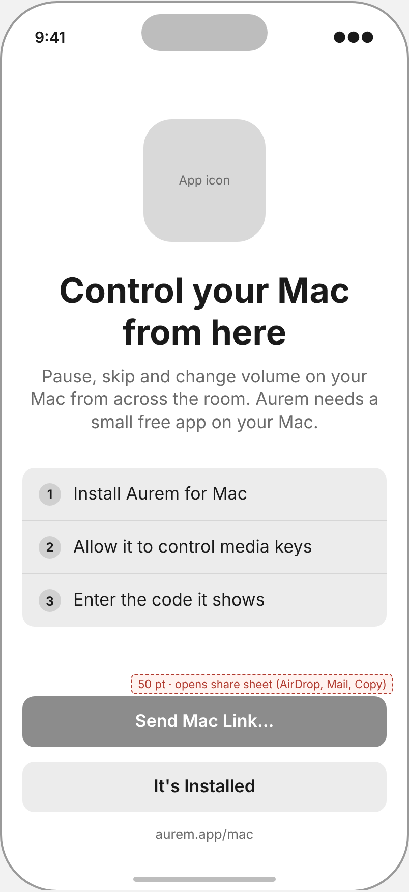
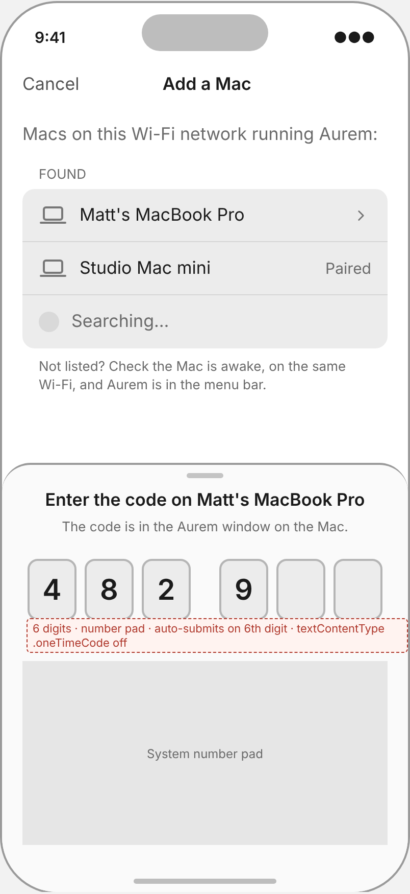
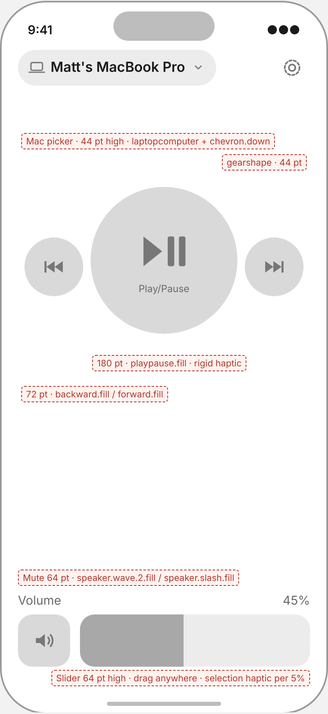
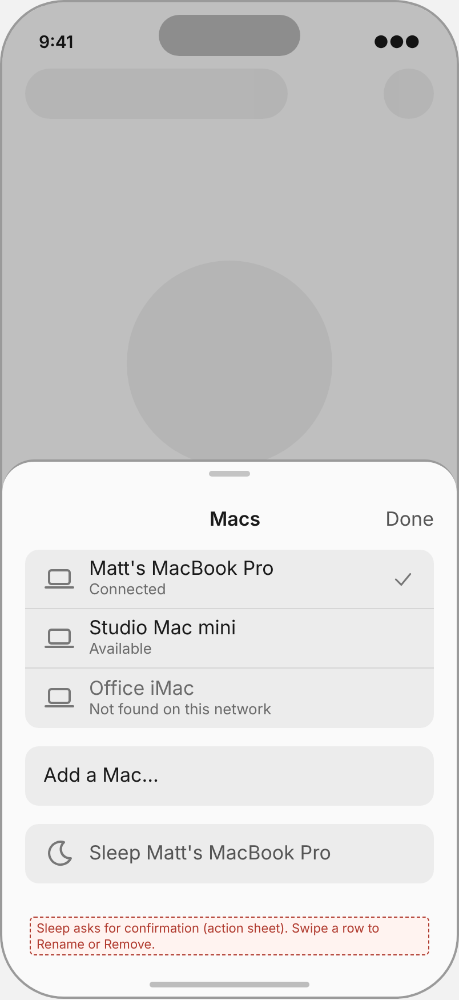
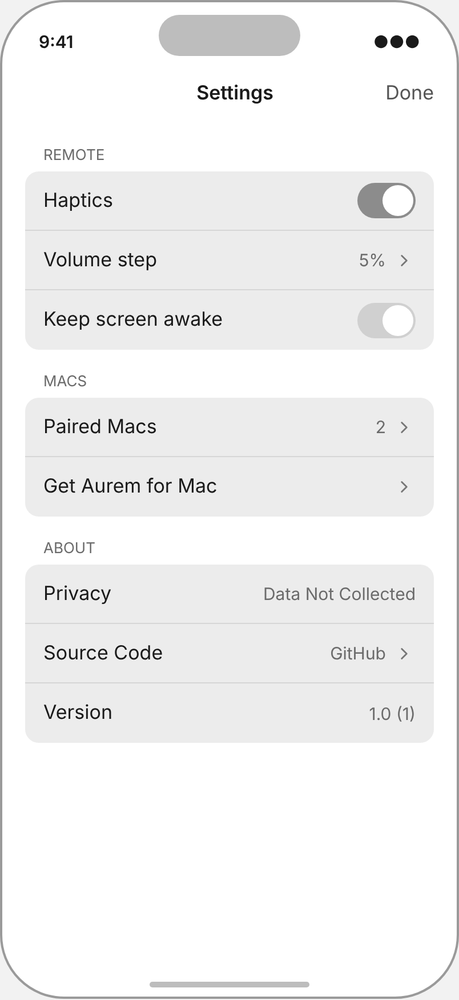
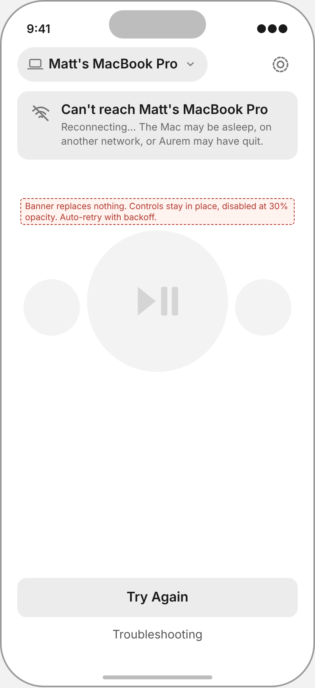
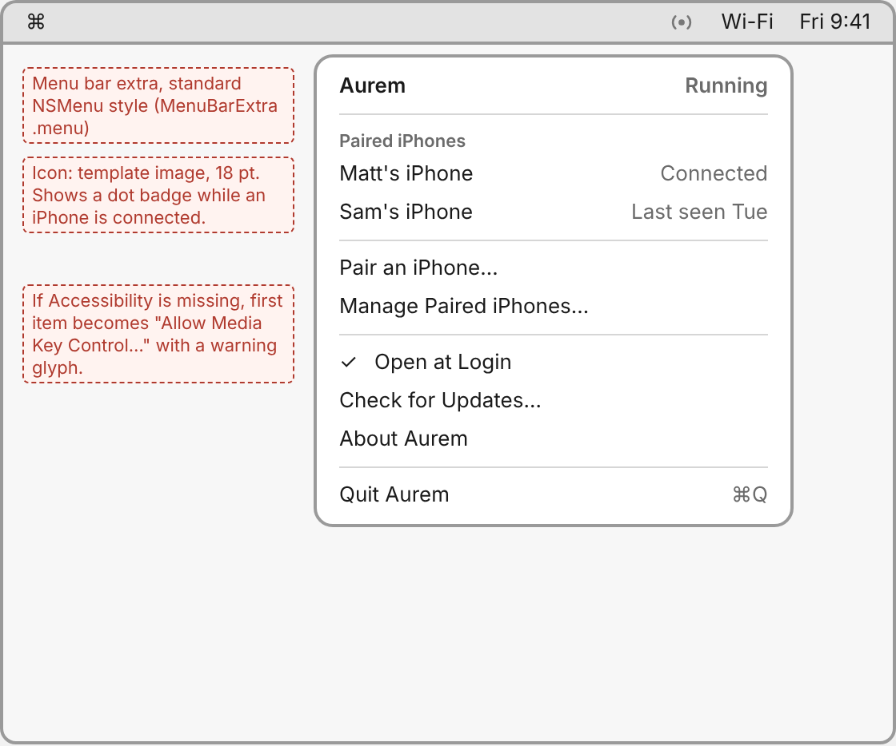
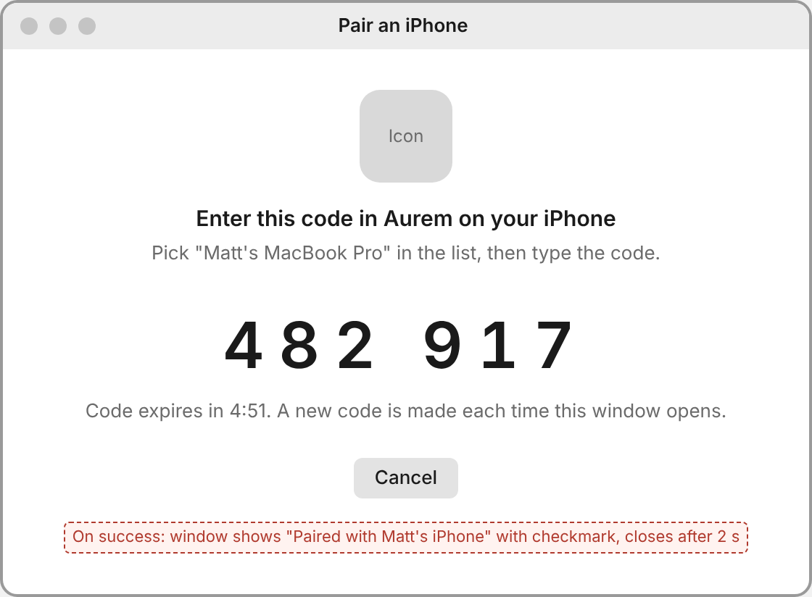
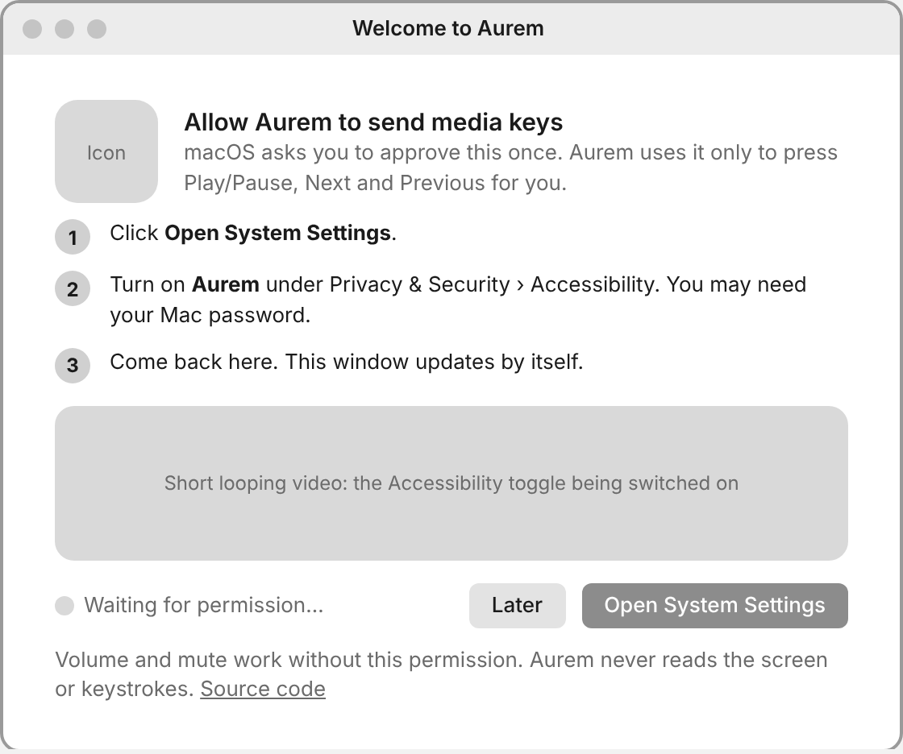

# P0.2 Low-fidelity wireframes

Source: [`wireframes/wireframes.html`](wireframes/wireframes.html). PNGs are rendered from it at 2x. iPhone frames are 402 × 874 pt (iPhone 16 Pro). Inter stands in for SF Pro, and grey glyphs stand in for the SF Symbols named in the annotations.

## iPhone

| Code | Screen | Image |
|---|---|---|
| W1 | First launch |  |
| W2 | Pairing (Mac list + code sheet) |  |
| W3 | Main remote |  |
| W4 | Mac picker |  |
| W5 | Settings |  |
| W6 | Connection lost |  |

## Mac

| Code | Screen | Image |
|---|---|---|
| M1 | Menu bar menu |  |
| M2 | Pairing window |  |
| M3 | Permissions onboarding |  |

## Control sizes

| Control | Size | Reason |
|---|---|---|
| Play/pause | 180 pt | Primary action. Hit without looking. |
| Previous / next | 72 pt | Secondary. Well above the 44 pt HIG minimum. |
| Volume slider | full width × 64 pt | Bottom of screen is the easiest thumb reach. Drag anywhere on the bar, not only the knob. |
| Mute | 64 pt | Same row and height as the slider. |
| Mac picker, settings | 44 pt | HIG minimum. Used rarely. |
| Pairing code digits | 48 × 60 pt | Read on phone, typed with number pad. |
| Mac pairing code text | 44 pt type | Readable from about 3 m. |

## Layout decisions in the wireframes

1. W-D1 Play/pause is shown as one toggle glyph (`playpause.fill`). The app cannot know play state without Now Playing data, which v1 excludes (C5, C6). See F5.
2. W-D2 Sleep is in the Mac picker behind a confirmation, not on the main remote. Aurem cannot wake the Mac in v1, so an accidental tap would end the session.
3. W-D3 The connection-lost state keeps every control in place, disabled. The layout does not jump, so muscle memory survives a reconnect.
4. W-D4 The Mac app is a plain menu bar menu with no settings window. Pairing and permission are the only windows.
5. W-D5 On the Mac, "Later" on the permission screen still allows pairing. Volume and mute work without Accessibility, so the user gets a working remote sooner.

States not yet drawn and added at P1: volume not adjustable on this output (F7), Accessibility not granted (play/pause disabled with "Allow on your Mac"), Local Network denied on iPhone, empty Mac list, wrong pairing code, Dynamic Type at the largest size.
