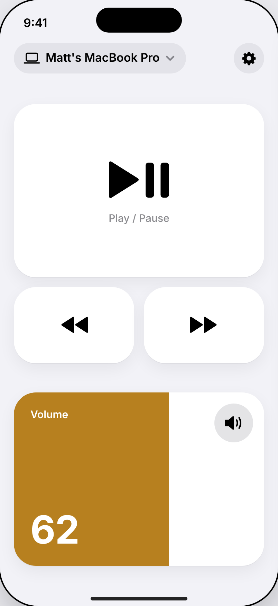
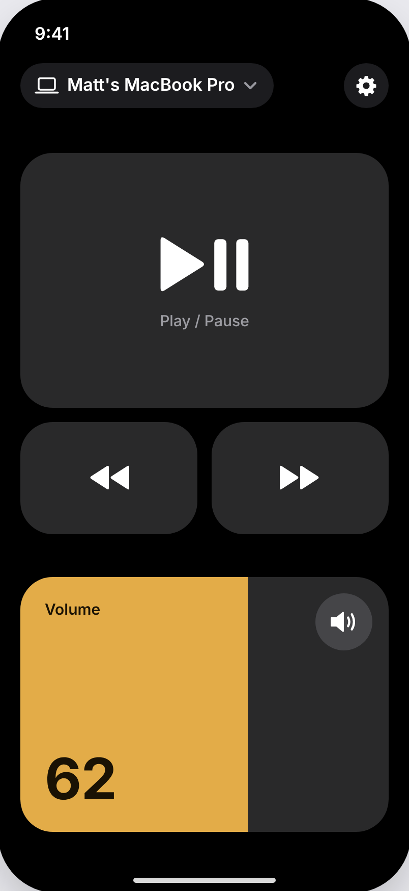
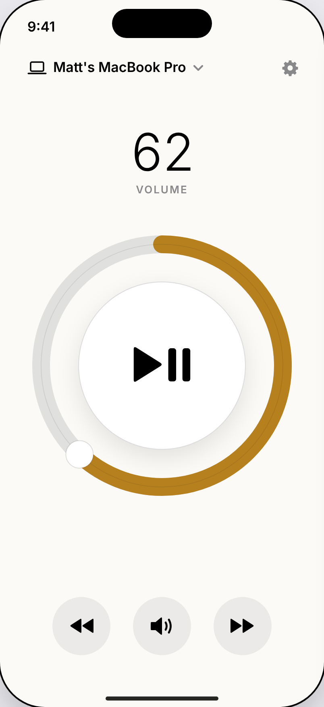
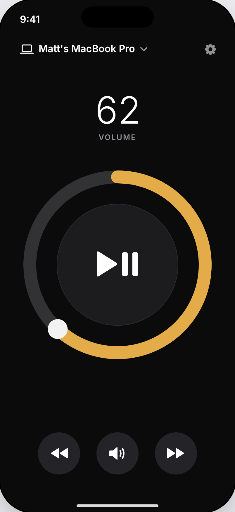
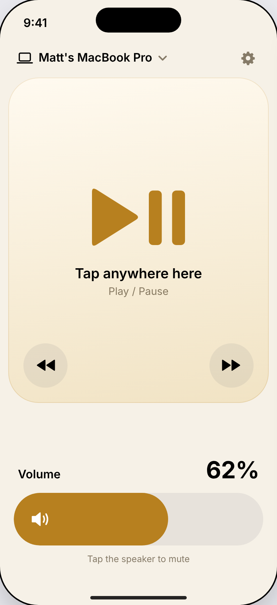
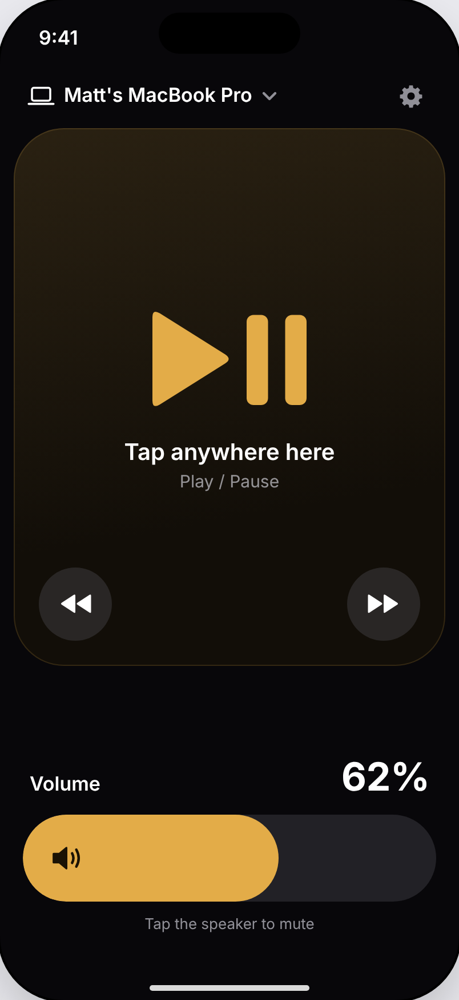

# P0.3 Main remote: three visual directions

Source: [`directions/directions.html`](directions/directions.html). Rendered at 402 × 874 pt, 2x. Same state in every render: connected to "Matt's MacBook Pro", volume 62%. Accent is Aurem gold: #B7801F in light, #E3AC48 in dark.

## O1 Direction A · Control Center

Rationale: reuse the tile language iPhone owners already know from Control Center, so the remote feels like part of iOS on first sight.

| Light | Dark |
|---|---|
|  |  |

## O2 Direction B · Dial

Rationale: one physical-feeling control, a volume ring around a play button, so the hand learns one gesture for everything that matters.

| Light | Dark |
|---|---|
|  |  |

## O3 Direction C · Surface

Rationale: the top half of the screen is one play/pause target and the bottom is one volume bar, so it works without looking at the phone.

| Light | Dark |
|---|---|
|  |  |

## Comparison

| Criterion | A | B | C |
|---|---|---|---|
| Pause without looking | Good. 362 × 250 pt tile. | Fair. 208 pt disc, ring around it catches stray taps. | Best. 378 × 470 pt surface. |
| Volume without looking | Good. 362 × 250 pt bar. | Poor. Circular drag needs eyes and two hands on large phones. | Good. Full-width 76 pt bar. |
| VoiceOver | Plain buttons and an adjustable slider. | Ring needs a custom adjustable element. Rotary drag has no VoiceOver equivalent. | Plain, but "tap anywhere" must be one labelled button. |
| Dynamic Type at AX5 | Tiles reflow to one column. | Ring cannot grow. Numeral must cap. | Labels wrap inside the panel. Fine. |
| Fits iOS design language | Highest. Same shapes as Control Center. | Low. Reads as a skeuomorphic gadget. | Medium. Custom gradient panel. |
| Build cost | Low. Stock SwiftUI shapes and `Slider` replacement. | High. Custom gesture, hit-testing, accessibility. | Low to medium. |
| Distinct from competitors | Medium. | High. | High. |

## Recommendation

Direction A, with one change taken from C: the play/pause tile grows to fill all space between the header and the skip row, so it remains the largest target on every phone size.

Why A over C: C wins on eyes-free use, but its single gradient surface carries no information and its "tap anywhere" panel invites accidental pauses when the phone is picked up. A gets most of C's target size, matches Control Center, which the user already operates without thinking, and costs least to build and make accessible. Why not B: the circular volume gesture fails the across-the-room, one-hand case and has no VoiceOver equivalent.
