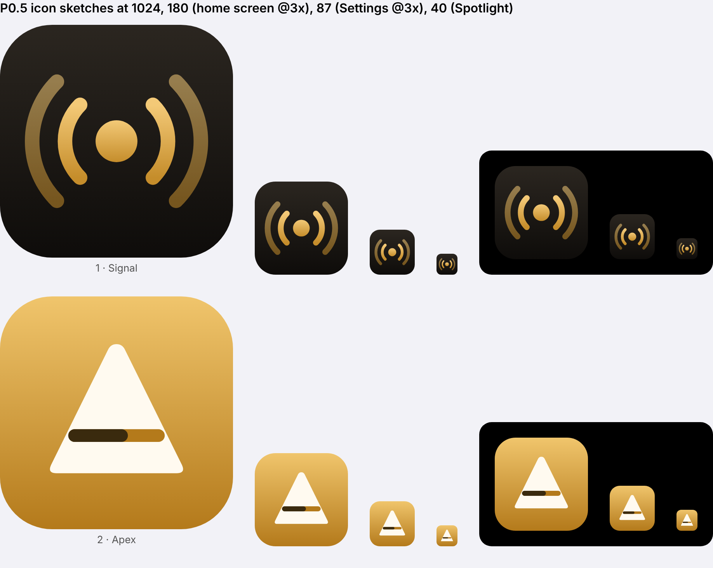

# P0.5 Name check and icon direction

Checks run 2026-10-16 against the live registers. Raw results are in [`name-check/`](name-check/).

## Result: AUREM fails US clearance

| Code | Check | Result | Evidence |
|---|---|---|---|
| N1 | USPTO, "AUREM" | **Live application, serial 99803766, AUREM, filed 2026-05-04, intent-to-use. Class 9: "Downloadable software in the nature of a mobile application for journaling, personal reflection, and digital scrapbooking." Class 18: bags. Applicant Michelle Hernandez, Laguna Beach, California.** | `uspto-aurem.json` |
| N2 | USPTO, other live AUREM marks | AUREM PGI, serial 99772031, Class 42 SaaS for risk analytics. AUREM, serial 99662094, Class 3 hair care. | `uspto-aurem.json` |
| N3 | USPTO, `AUREM*` | 21 marks. No other live Class 9 or 42 mark. Dead: AUREMA (Class 9 and 42, Australian owner). | `uspto-aurem-wildcard.json` |
| N4 | IPONZ, "AUREM" and "AUREM*" | No results. Control search for "SPOTIFY" returns its registrations, so the search method works. | `iponz-aurem.txt`, `iponz-control-spotify.txt` |
| N5 | App Store US and NZ, "aurem" | Three live apps: "Aurem - Customizable Journal" (Aurem Journal LLC, id6779089024, released 2026-06-18), "Aurem Bullion.", "Aurem Finance". | `appstore-us-search.json` |
| N6 | aurem.app | Registered 2023-09-19 at GoDaddy, renewed to 2027-09-19. | `rdap-aurem.app.json` |
| N7 | aurem.com | Registered since 2000-01-07 at Network Solutions. | `rdap-aurem.com.json` |
| N8 | getaurem.com | Registered 2026-03-16 at Namecheap. | `rdap-getaurem.com.json` |
| N9 | auremapp.com | Registered 2026-07-02 at Hostinger. Parked. | `rdap-auremapp.com.json` |
| N10 | Unregistered in RDAP | useaurem.com, tryaurem.com, auremremote.com, heyaurem.com, getaurem.app, useaurem.app, auremremote.app, aurem.page. Price and premium status not checked. | Command output in session |

N1 and N5 are almost certainly the same business: a journaling app named Aurem, filed in Class 9 in May 2026 and on the App Store since June 2026.

## Assessment

1. **US registration is likely blocked.** N1 is the identical word, filed earlier, for downloadable mobile app software. A US examiner compares marks first, and identical marks need only related goods. Two iPhone apps sold in the same store are likely to be found related even though one is a journal and one is a remote. Expect a refusal under Section 2(d), or a suspension until N1 is decided.
2. **US use carries a claim risk.** The journal app has used AUREM in US commerce since June 2026, before us. Its owner could object to a second "Aurem" iPhone app.
3. **NZ is clear.** A NZ filing is possible, but the target market is the US (Q3).
4. **No short domain is free.** aurem.app, aurem.com and getaurem.com are all taken. Only prefixed or suffixed names are open (N10).
5. **The MIT problem stays.** Without a registered mark, nothing stops clones from shipping under the same name (R5).

This is not legal advice. A US trademark attorney can say whether N1 is beatable, for example if it is never used in commerce and lapses. That costs time and money with an uncertain outcome.

## Options

1. **O-n1 Rename now (recommended).** Nothing is built yet, so this is the cheapest point. Run every candidate through the same four checks before choosing.
2. **O-n2 Keep Aurem and do not register in the US.** Ship as "Aurem — Remote for Mac" on a domain such as useaurem.com. This accepts N1's prior rights, no protection against clones, and a rebrand later at higher cost.
3. **O-n3 Keep Aurem and ask an attorney about N1** before deciding. This adds weeks and money, and the answer may still be no.

## Rename screening (O-n1 chosen 2026-10-16)

27 invented names were run through the same checks. Raw results: `name-check/rename-*.json`.

Screens, in order:
1. USPTO: no live mark with the same word in Classes 9, 15, 38 or 42.
2. IPONZ: no live mark with the same word in those classes.
3. App Store US: no app using the word.
4. Web: no established brand in audio or software.

| Name | Result | Reason |
|---|---|---|
| Pausa, Tamber, Velora, Halio, Ambry, Tacit, Seren, Ollo, Quell, Corva, Tavi, Sorrel | Out at screen 1 | Live US marks in Class 9 or 42. |
| Orva | Out at screen 1 and 2 | Live US Class 42 marks and a NZ Class 9 registration. |
| Aurio, Lullo, Kiru, Lumet, Nuvel, Halden, Pauso, Ovro | Out at screen 3 | Existing App Store apps with the name. |
| Auvio | Out at screen 4 | Name of the Belgian broadcaster RTBF's streaming service. |
| Quorra | Out at screen 4 | Disney character name (Tron: Legacy). |
| Ovra | Out at screen 4 | Name of Mussolini's secret police. |
| Ellum | Out at screen 4 | Ellum Audio is an established record label. |
| **Auvel** | **Passes all four** | 0 live US marks of any class. No NZ marks. No apps. No web presence found. |
| **Murmo** | **Passes all four** | 0 live US marks of any class. No NZ marks. No apps. Close to "Murmur", a US film studio, in a different field. |

Domains for the two finalists:

| Name | .com | .app | Free variants |
|---|---|---|---|
| Auvel | auvel.com registered 2016, parked on NameBright DNS, which domain resellers use. Likely for sale. | auvel.app registered 2026-09-09 on Cloudflare. Owner and purpose unknown. | auvel.net, getauvel.com, useauvel.com, auvelapp.com, getauvel.app, useauvel.app |
| Murmo | murmo.com registered 2004, on NameFind (GoDaddy aftermarket). Likely for sale. | Registered. | getmurmo.com, usemurmo.com, murmoapp.com, getmurmo.app, usemurmo.app |

Assessment: Auvel is the stronger mark. It keeps "Au" (gold, audio) from Aurem, so the gold accent, the icon and the ecosystem idea carry over unchanged. Murmo is softer and more playful, but closer to the common word "murmur", which makes it weaker as a mark. The recent auvel.app registration is the one open question. It could be a project that is about to launch under the same name.

## Icon direction

Sketches: [`icon/icon-1-signal.svg`](icon/icon-1-signal.svg), [`icon/icon-2-apex.svg`](icon/icon-2-apex.svg). Sheet at app sizes on light and dark: 

| Code | Sketch | Idea | Assessment |
|---|---|---|---|
| I1 | Signal | Gold source dot with sound arcs on both sides, on warm graphite. | Reads well at 40 px. Too close to the SF Symbol `dot.radiowaves.left.and.right` and to podcast and broadcast icons. Not distinctive. |
| I2 | Apex | A play triangle turned upward to form an "A". The crossbar is a volume level. Gold ground. | Carries the name and both core functions (play, volume). Distinct on the home screen. The crossbar gets thin at 40 px and needs thickening at P1. |

Original recommendation: I2. G0 decision (D5, 2026-10-16): Matt chose I1. It is redrawn at P1 so it no longer resembles the SF Symbol (R9 in the [G0 packet](README.md#risks-added-after-the-decisions)).
