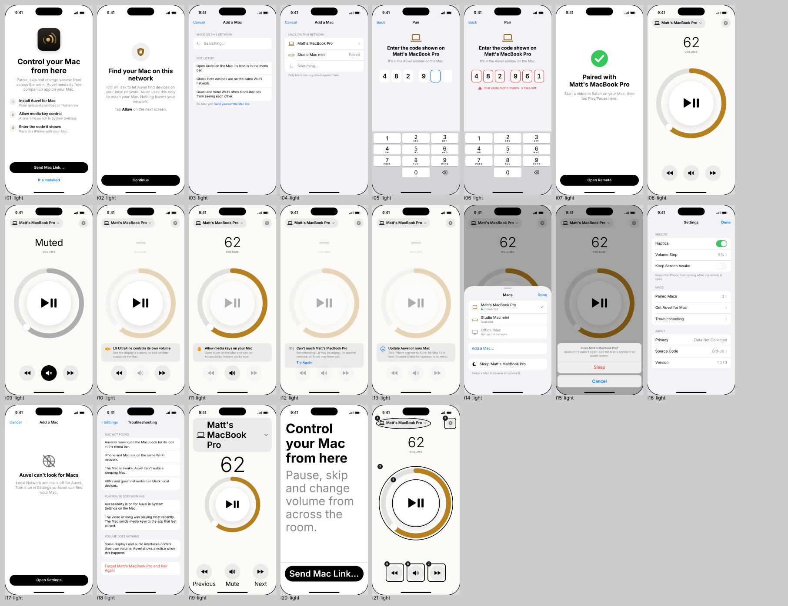
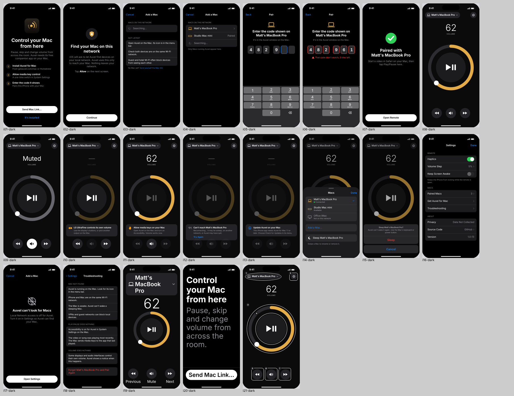
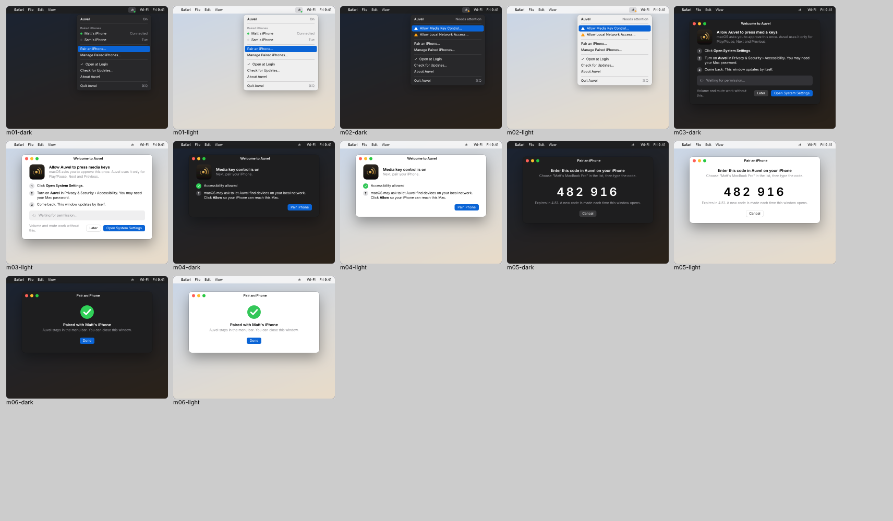
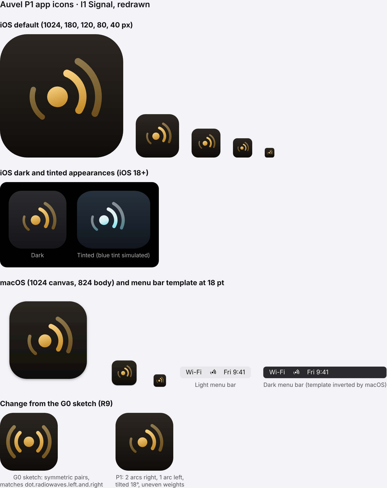

# Phase 1 design · G1 review packet

Status: ready for review. No production code written.

**Reminder before Phase 2 (Q6):** rename the GitHub repo from `aurem` to `auvel`. Phase 2 creates CI and the Homebrew tap, which both reference the repo name.

## G1 evidence

| Item | Where |
|---|---|
| Design system: colour, type, spacing, SF Symbols, motion, haptics for iPhone, Mac and website | [design-system.md](design-system.md) |
| Contrast measurements | [contrast.txt](contrast.txt) |
| Written design philosophy, for reuse on the website | [design-philosophy.md](design-philosophy.md) |
| VoiceOver labels | [voiceover.md](voiceover.md) |
| Full screen set, light and dark: 21 iPhone and 6 Mac screens, 54 renders | [screens/](screens/), overviews below |
| Icon set: iOS default, dark and tinted, macOS, menu bar template | [icon/](icon/) |

Rendering limits: Inter stands in for SF Pro and drawn glyphs stand in for SF Symbols. Renders are HTML mock-ups at device size (402 × 874 pt, 2x), not screenshots of running code. The source is `screens/screens.html`.

## Screens

| Code | State | P0 source |
|---|---|---|
| I01 | First launch | W1 |
| I02 | Local network explainer, before the iOS prompt | X12 |
| I03 | Mac list, searching, empty | W2 |
| I04 | Mac list with results | W2 |
| I05 | Pairing code entry | W2 |
| I06 | Wrong code | X14 |
| I07 | Paired, first-pause tip | X16 |
| I08 | Remote, connected | W3, D1 |
| I09 | Remote, muted | W3 |
| I10 | Remote, volume not adjustable | F7, X18 |
| I11 | Remote, Accessibility not granted on the Mac | X9 |
| I12 | Remote, can't reach Mac | W6 |
| I13 | Remote, Mac app out of date | X24 |
| I14 | Mac picker | W4 |
| I15 | Sleep confirmation | W-D2, X23 |
| I16 | Settings | W5 |
| I17 | Local network denied | X12 |
| I18 | Troubleshooting | W6 |
| I19 | Remote at AX5 Dynamic Type | R10 |
| I20 | First launch at AX5 Dynamic Type | — |
| I21 | VoiceOver focus order | R10 |
| M01 | Menu bar menu, iPhone connected | M1 |
| M02 | Menu, permissions missing | M1, X11 |
| M03 | Permission onboarding, waiting | M3 |
| M04 | Permission granted, local network explained | M3, X11 |
| M05 | Pairing code | M2 |
| M06 | Pairing succeeded | M2 |

Overviews:   

## Icons

I1 (Signal) is redrawn to clear R9. The symmetric arc pairs of the G0 sketch are gone. It now has two arcs on the right and one on the left, uneven stroke weights, an 18° tilt and a gold gradient. Residual risk: it still belongs to the same family as `dot.radiowaves.right`. If App Review or your own eye finds it too close, the fallback is I2 (Apex) from P0.5.

## How the R10 conditions for Direction B are met

| R10 condition | Where |
|---|---|
| Straight vertical drag changes volume | Design system §6.4 |
| Dial is one VoiceOver adjustable element in 5% steps | voiceover.md #3, I21 |
| Haptic detents every 5%, stronger at 0% and 100% | Design system §7 |
| AX sizes: numeral caps, buttons move to a labelled row | Design system §6.2, I19 |

## New findings

1. **F10** Light-mode gold #B7801F is 3.43:1 on white, not 4.5:1 as P0.3 said. It is used only for graphics, which need 3:1. Text uses `goldText` #94661A at 5.03:1. Increase Contrast swaps in #8A5F12 at 5.64:1.
2. **F11** The remote's state banners sit between the dial and the button row. The dial and buttons never move, which keeps the W-D3 rule from Phase 0.

## Decisions requested at G1

1. **D6** Approve the screen set.
2. **D7** Approve the redrawn I1 icon, or fall back to I2 (Apex).
3. **D8** Approve the design philosophy text for the website.
